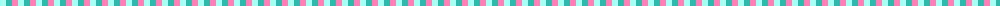
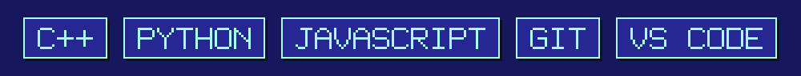

  

I write code, mostly C++, Python and JavaScript. AI and automation are what I'm most into, and I like starting projects, running them, and teaching people to code along the way.

## Projects

**[digit-neural-network](https://github.com/lanethegoat/digit-neural-network)**
My science fair project: a small neural network that reads handwritten digits. It gets 95.0% of the MNIST test set right, and the training code and results are in the repo if you want to check my numbers.

**[amc-booking](https://github.com/lanethegoat/amc-booking)**
A Playwright script that picks AMC seats and tickets for me and stops at checkout. I can kill it from my phone.

## Tools

  

  

