<!-- Header wave -->

  

<!-- Typing animation -->

  

  

---

###  About me

- 💻 I write code in **C++**, **Python** and **JavaScript**
- 👨‍🏫 I enjoy teaching teammates how to code
- 🧠 Interested in **programming, robotics, AI**, and starting and leading new projects
- 🌱 Always learning something new

---

### 🛠️ Tech I use

  

  
  
  
  

---

### 🐍 Snake eating my contributions

  <picture>
    <source media="(prefers-color-scheme: dark)" srcset="https://raw.githubusercontent.com/lanethegoat/lanethegoat/output/github-snake-dark.svg" />
    
  </picture>

Each square is a day I committed code. The more I build, the more the snake gets to eat.

<!-- Footer wave -->

  

